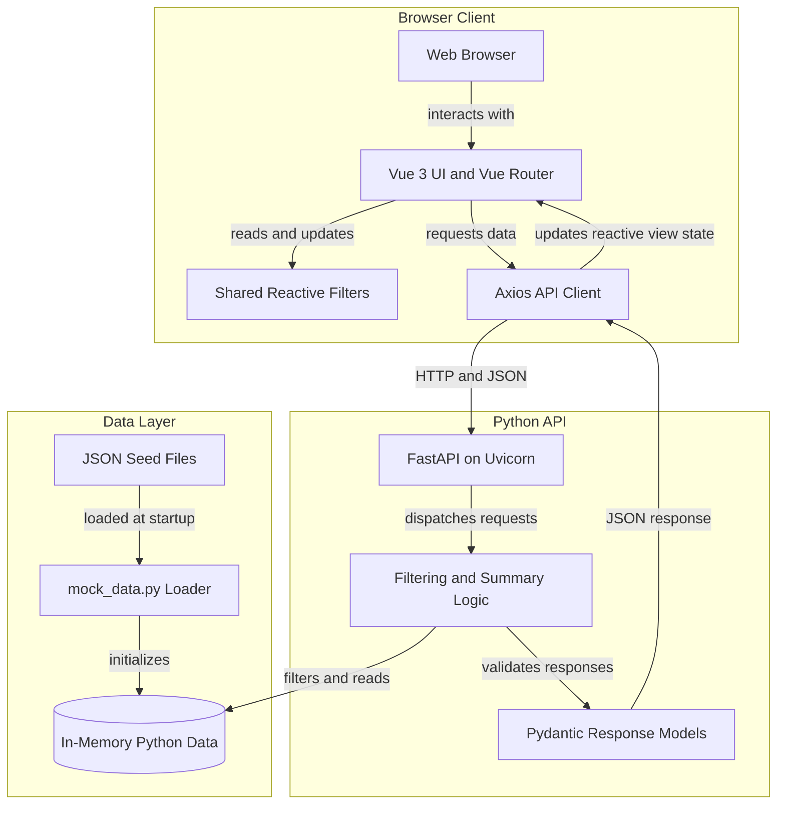
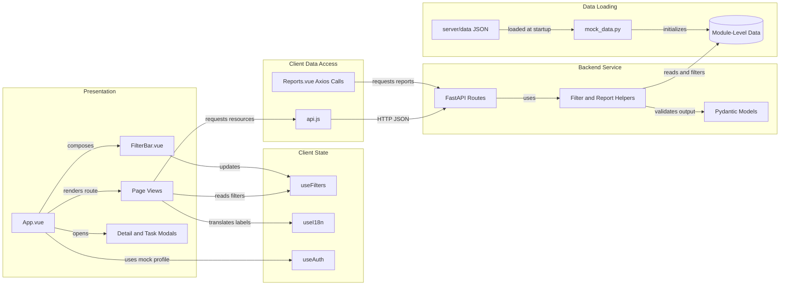

# Architecture Diagram

This demo pairs a Vue single-page application with a FastAPI service. The API reads JSON seed files into memory at startup, so there is no database or durable runtime storage.

## Application Architecture

<!-- mermaid-checked: no \n, no em-dash/en-dash, no {} in labels, subgraphs are id["label"], arrows are -->|"label"|, all subgraphs closed by end, ids unique -->

### Technology Stack Summary

| Layer | Technology | Version | Purpose |
|---|---|---|---|
| Frontend | Vue 3 | ^3.4.21 | Component UI and reactive state |
| Build | Vite | ^8.0.0 | Development server and production build |
| Routing | Vue Router | ^4.3.0 | Client-side routes |
| HTTP | Axios | ^1.6.7 | Browser-to-API requests |
| Backend | Python | >=3.11 | API runtime |
| API | FastAPI | >=0.110.0 | HTTP endpoints and OpenAPI |
| Validation | Pydantic | >=2.5.0 | Typed request and response models |
| ASGI server | Uvicorn | >=0.24.0 | Serves API on port 8001 |
| Data | JSON and Python memory | Local demo data | Seed records and in-process filtering |

### Data Storage & External Services

The backend loads inventory, orders, demand forecasts, backlog, spending, transactions, and purchase-order seed files from `server/data/` through `server/mock_data.py`. Data is held in module-level Python values and filtered or summarized in process; there is no database, cache, message broker, or required external service. Runtime changes are not durable across restarts.

### Key Architectural Decisions

- The frontend and API run as separate local development servers and communicate over HTTP using JSON.
- Shared Vue composables hold filter and localization state; views store API results in refs and derive display values with computed properties.
- The backend is a compact single-module FastAPI service with inline filtering/report calculations and Pydantic response models.
- Authentication/profile behavior is mocked in the frontend, and backend CORS currently permits all origins for development.

## Component Relationships

<!-- mermaid-checked: no \n, no em-dash/en-dash, no {} in labels, subgraphs are id["label"], arrows are -->|"label"|, all subgraphs closed by end, ids unique -->

### Component Inventory

| Component | Layer | Type | Responsibility |
|---|---|---|---|
| `App.vue` | Presentation | Vue application shell | Navigation, shared filter bar, route outlet, profile and task modals |
| `FilterBar.vue` | Presentation | Vue component | Edits the common period, warehouse, category, and status filters |
| Page views | Presentation | Vue views | Load endpoint data and render dashboards, tables, charts, and detail UI |
| Detail and task modals | Presentation | Vue components | Show record details and local task interactions |
| `useFilters.js` | Client state | Vue composable | Shared singleton filter refs and current API filter mapping |
| `useI18n.js` | Client state | Vue composable | Locale, translations, and currency display state |
| `useAuth.js` | Client state | Vue composable | Mock current user and client-only sign-in state |
| `api.js` | Client data access | Axios module | Centralizes most API calls at `http://localhost:8001/api` |
| `Reports.vue` | Client data access | Vue view | Calls quarterly and monthly report endpoints directly with Axios |
| FastAPI routes | Backend service | HTTP endpoints | Serve inventory, order, demand, backlog, dashboard, spending, and reports |
| Filter and report helpers | Backend service | Python functions | Apply optional filters and compute report/dashboard aggregates |
| Pydantic models | Backend service | Data models | Validate typed inventory, order, demand, backlog, and purchase-order responses |
| `mock_data.py` | Data loading | Python module | Loads JSON seed datasets into process memory |
| `server/data/*.json` | Data loading | Seed files | Provide the demo records read at backend startup |
| Module-level data | Data layer | In-memory values | Supplies endpoint reads and in-process calculations |

Note: `api.js` also declares task and purchase-order client methods, but corresponding handlers are not currently present in `server/main.py`.
